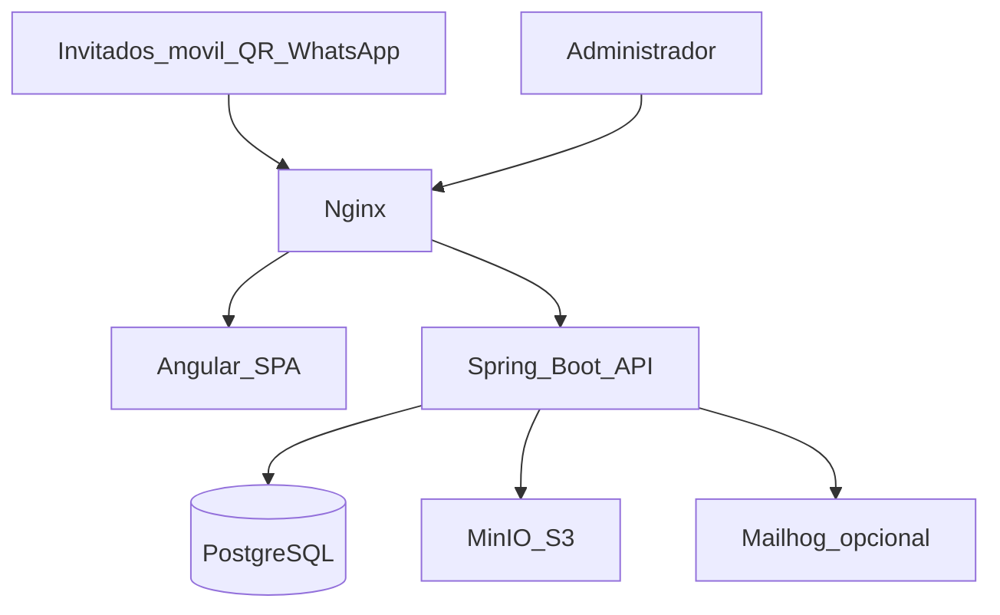
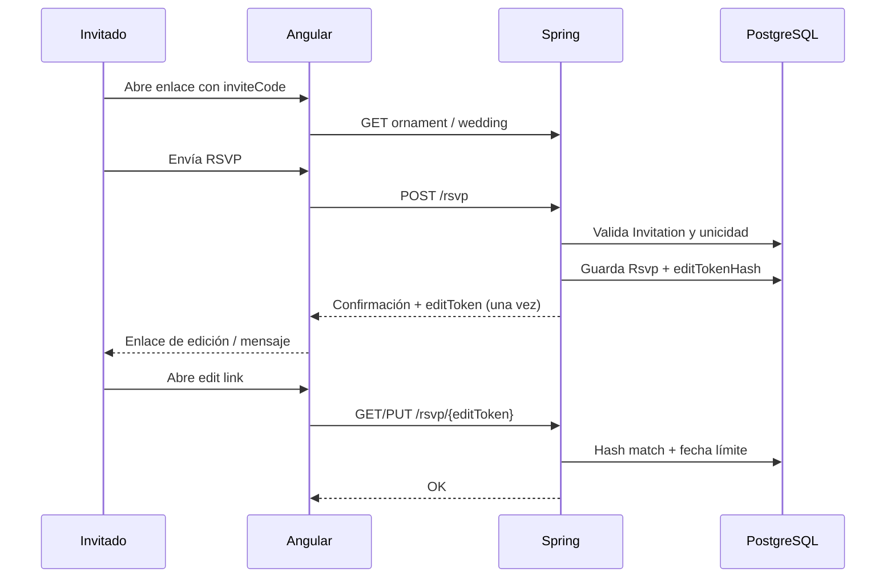

# Plan de desarrollo — weddinglage (boda navideña)

**Fecha de referencia del plan:** 1 de noviembre de 2026  
**Fecha de la boda:** 18 de diciembre de 2027  
**Zona horaria:** Europe/Madrid  
**Especificación base:** [`especificacion-boda-navidena.md`](./especificacion-boda-navidena.md)

------------------------------------------------------------------------

## Ambigüedades detectadas (antes de asumir)

| Tema | Lectura | Decisión del plan |
|------|---------|------------------|
| «Una respuesta por invitado» vs familias | Conflicto aparente | **Una RSVP por `Invitation`**, con N asistentes ≤ `maxAttendees` |
| Portada rica vs hero limpio | Spec pide nombres, fecha, countdown y atajos | Priorizar identidad (nombres + fecha + atmósfera); atajos bajo el fold en móvil |
| Publicación fotos 25/12/2027 | Solo ejemplo en spec original | **Pendiente**; no fijar en código |
| Capacidad autobuses | Sin datos | UI lista para cupos; bloquear o waitlist **cuando** se configure |
| Auth «sesión o JWT» en spec antigua | Ambigüedad | **Cookie HttpOnly + CSRF** (fijado) |
| PWA / guestbook / árbol | En spec original como parte del producto | **Post-MVP** |
| Repo público vs privado | Wedding data / IBAN | Preferir **privado**; el usuario crea/sube el remoto |

------------------------------------------------------------------------

## 1. Resumen ejecutivo y alcance

### Qué se construye

Monorepo **weddinglage**: web de boda navideña (Angular) + API (Spring Boot) + PostgreSQL + MinIO, servidos con Nginx en Docker. Primero todo en **local** con Compose; después el mismo artefacto en un **VPS** (HTTPS, backups). GitHub es el remoto de código; no es el hosting de la app.

### MVP (incluido)

- Cimientos Docker + admin/config mínimo (sin hardcode de contenidos).
- Web pública mobile-first: bienvenida, countdown, historia, venue, timeline, IBAN desde API.
- RSVP por código de invitación + edición con `editToken` hasheado.
- Adornos por invitación (sin árbol virtual).
- Galería QR con token de subida, moderación y doble condición de publicación.
- Admin: dashboard, invitados, fotos, exports básicos, hardening esencial.

### Fuera de MVP (post)

- PWA, libro de firmas, árbol virtual, MFA, ZIP masivo de fotos, migración a R2/S3 si el volumen lo exige.

### Ruta de trabajo

```text
Local (Compose) → GitHub (código) → VPS (tú despliegas cuando quieras)
```

------------------------------------------------------------------------

## 2. Arquitectura

### Diagrama



### Justificación de decisiones

| Decisión | Por qué |
|----------|---------|
| Angular + Spring | Stack conocido del autor; tipado y ecosistema maduro |
| Cookie + CSRF | Admin de bajo volumen; evita JWT en `localStorage`; mismo origen vía Nginx |
| MinIO | S3-compatible barato y portable (local = VPS); migrable a R2/S3 |
| Invite codes | Evita RSVP spam anónimo; encaja con WhatsApp/QR |
| editToken hasheado | Nombre/email no son secretos; enlace de edición revocable |
| Monorepo | Un solo Compose y contratos frontend/backend alineados |
| Local-first | Coste ~0 mientras se desarrolla; VPS cuando haya dominio/contenido real |

### Estructura del repositorio

```text
weddinglage/
  frontend/     # Angular
  backend/      # Spring Boot
  docker/       # Nginx, Compose overlays, scripts
  docs/         # Especificación y este plan
  README.md
```

------------------------------------------------------------------------

## 3. Modelo de datos

### Distinciones clave

- **Invitation** — unidad de gestión (individual o familiar), `inviteCode`, `maxAttendees`.
- **Guest** — persona perteneciente a una invitación.
- **Asistente confirmado** — resultado del RSVP (conteo ≤ `maxAttendees`), no necesariamente 1:1 con filas Guest hasta que se modele el detalle.

### Entidades y campos clave

| Entidad | Campos clave | Relaciones |
|---------|--------------|------------|
| `AdminUser` | `email`, `passwordHash`, `roles`, `failedLogins` | → `AdminAuditLog` |
| `Invitation` | `inviteCode` (único), `maxAttendees`, `label`, `active` | 1→N `Guest`; 0..1 `Rsvp`; 0..1 adorno |
| `Guest` | `firstName`, `lastName`, `email?`, `isChild` | N→1 `Invitation` |
| `Rsvp` | `attending`, `adults`, `children`, `notes`, `editTokenHash`, `submittedAt`, `updatedAt` | 1→1 `Invitation` |
| `DietaryRequirement` | `type`, `detail` | N→1 `Rsvp` / Guest |
| `TransportReservation` | `busSlot` (18:00/22:00), `stopId?`, `status` (CONFIRMED/WAITLIST) | N→1 `Rsvp`; cupo en config |
| `SongSuggestion` | `title`, `artist?` | N→1 `Rsvp` |
| `OrnamentType` | `code`, `name`, `imageKey` | — |
| `GuestOrnament` | `invitationId`, `ornamentTypeId` | único por invitación |
| `Photo` | `storageKey`, `thumbKey`, `mime`, `status`, `uploadedAt` | — |
| `PhotoUploadToken` | `tokenHash`, `expiresAt`, `revoked` | rate limit por token |
| `PhotoPublicationConfig` | `publishAt`, `adminAuthorized`, `authorizedBy`, `authorizedAt` | — |
| `Venue` | dirección, coords, textos | 1→N `VenueImage` |
| `TimelineEvent` | `time`, `title`, `description`, `sortOrder`, `icon` | — |
| `WeddingConfiguration` | pareja, fecha, IBAN, textos, flags de secciones | singleton lógico |
| `PlaylistTrack` | `title`, `sourceUrl` o asset, `licenseNote` | — |
| `BusCapacity` | `slot`, `capacity`, `waitlistEnabled` | opcional hasta conocer cupos |
| `AdminAuditLog` | `actor`, `action`, `entity`, `at` | — |

Índices: `inviteCode`, `editTokenHash`, estados de `Photo`, `busSlot` para conteos de cupo.

------------------------------------------------------------------------

## 4. Diseño de API REST

### Convenciones

- Prefijo `/api/public/**` sin sesión admin; `/api/admin/**` con cookie de sesión + CSRF.
- Errores JSON: `{ "code", "message", "details?" }`; códigos HTTP semánticos.
- Validación Bean Validation + mensajes en español cuando sea UX.

### Endpoints públicos (MVP)

| Método | Ruta | Notas |
|--------|------|-------|
| GET | `/api/public/wedding` | Config pública (sin IBAN parcial si se prefiere ofuscar; IBAN sí se muestra en sección regalo) |
| GET | `/api/public/venue` | |
| GET | `/api/public/timeline` | |
| GET | `/api/public/ornaments/{inviteCode}` | 404 si código inválido |
| POST | `/api/public/rsvp` | body + `inviteCode`; 409 si ya existe |
| GET/PUT | `/api/public/rsvp/{editToken}` | token en claro una vez; rate limit |
| POST | `/api/public/photos` | header/query `uploadToken`; multipart |
| GET | `/api/public/photos` | vacío/403 si no hay publicación efectiva |
| GET | `/api/public/photos/{id}/content` | URL firmada o redirect temporal |

### Endpoints admin (MVP)

| Método | Ruta | Notas |
|--------|------|-------|
| POST | `/api/admin/auth/login` | set-cookie |
| POST | `/api/admin/auth/logout` | |
| GET | `/api/admin/dashboard` | agregados reales |
| CRUD | `/api/admin/invitations` | genera `inviteCode` |
| POST | `/api/admin/invitations/{id}/ornament` | assign manual/random |
| GET/PATCH | `/api/admin/photos/{id}` | approve/reject/delete |
| GET/PUT | `/api/admin/publication` | fecha + authorize flag |
| CRUD | `/api/admin/timeline`, `/venue`, `/configuration`, `/playlist` | |
| GET | `/api/admin/exports/guests\|catering\|transport\|songs\|ornaments` | CSV/XLSX |

### DTOs principales

- `PublicWeddingDto`, `VenueDto`, `TimelineEventDto`
- `RsvpSubmitRequest`, `RsvpViewDto`, `RsvpUpdateRequest`
- `PhotoUploadResponse`, `PhotoPublicDto`
- `InvitationAdminDto`, `DashboardDto`, `PublicationConfigDto`

### Errores frecuentes

| Código | HTTP | Cuándo |
|--------|------|--------|
| `INVALID_INVITE` | 404/403 | Código inexistente o inactivo |
| `RSVP_EXISTS` | 409 | Ya hay respuesta; usar edit link |
| `RSVP_CLOSED` | 403 | Pasó fecha límite |
| `INVALID_EDIT_TOKEN` | 401 | Token malo/revocado |
| `BUS_FULL` | 409 | Cupo agotado sin waitlist |
| `UPLOAD_DENIED` | 401/429 | Token inválido o rate limit |
| `INVALID_MEDIA` | 400 | MIME real no permitido |
| `NOT_PUBLISHED` | 403 | Galería aún cerrada |
| `UNAUTHORIZED` | 401 | Admin sin sesión |

------------------------------------------------------------------------

## 5. Flujos críticos

### 5.1. RSVP (una vez + edición)



**Casos límite**

- Correo mal escrito: no bloquea edición (el token sí); admin puede corregir con auditoría.
- Familia: un formulario; validar `adults + children ≤ maxAttendees`.
- Reenvío del formulario original: 409 + instrucción de usar enlace de edición.
- Pérdida del edit link: flujo admin «regenerar token» (invalida el anterior).

### 5.2. Subida y moderación de fotos

1. Admin genera/rota `PhotoUploadToken` e imprime QR (`/upload?t=...`).
2. Invitado sube; API valida token, rate limit, tamaño, **MIME real**, procesa strip EXIF/GPS, guarda en MinIO privado, estado `PENDING`.
3. Admin aprueba → `APPROVED` (aún no pública).
4. Publicación efectiva solo si `now >= publishAt` **Y** `adminAuthorized == true` → visibles como `PUBLISHED` (o filtro en query).

### 5.3. Doble condición de publicación

| `publishAt` alcanzada | `adminAuthorized` | ¿Visible? |
|-----------------------|-------------------|-----------|
| No | No | No |
| Sí | No | No |
| No | Sí | No |
| Sí | Sí | Sí |

Quitar autorización o retrasar fecha debe ocultar de nuevo la galería pública.

### 5.4. Asignación de adornos

- Manual: admin elige tipo para `Invitation`.
- Aleatoria: barajar tipos disponibles; si «sin repetición», excluir ya usados; si no hay suficientes tipos, error claro o permitir repetición según flag.

------------------------------------------------------------------------

## 6. Seguridad y privacidad (RGPD)

| Control | Implementación |
|---------|----------------|
| Auth admin | Cookie `HttpOnly` + `Secure` (prod) + `SameSite=Lax/Strict` + CSRF token |
| Passwords | Argon2 o bcrypt; rate limit login + lockout suave |
| RSVP | `inviteCode` + `editToken` hasheado (SHA-256 + pepper) |
| Upload | Token hasheado, caducidad, rate limit IP/token |
| Fotos | Bucket privado; URLs firmadas cortas; MIME real; strip GPS |
| Alergias | Solo roles admin; exports marcados confidenciales |
| Minimización | No pedir más campos de los necesarios |
| Derechos | Procedimiento manual MVP: export/borrado por admin + script SQL documentado |
| Retención | Definir borrado post-boda (p. ej. 6–12 meses) — fecha exacta pendiente |
| Aviso fotos | Texto legal configurable antes de subir |
| Logs | Sin PII innecesaria; auditoría de acciones admin |
| MFA | Post-MVP |

------------------------------------------------------------------------

## 7. Plan por fases (tareas, entregables, aceptación, esfuerzo)

Esfuerzo orientativo para **1 persona a ratos libres** (horas).

### Fase 0 — Cimientos (~20–30 h)

**Entregable:** `docker compose up` sirve SPA + API + Postgres + MinIO; login admin; config mínima editable.

- [ ] Inicializar `backend/` Spring Boot (Java LTS), Flyway, Actuator health
- [ ] Inicializar `frontend/` Angular (standalone, SCSS, mobile shell)
- [ ] Compose: `postgres`, `minio`, `api`, `web`/`nginx`, opcional `mailhog`
- [ ] Nginx: `/` → SPA, `/api` → backend, same-origin cookies
- [ ] Spring Security: form/login JSON o endpoint login + CSRF
- [ ] Entidad `WeddingConfiguration` + GET público + PUT admin
- [ ] Usuario admin seed por variables de entorno (no commit de secretos)
- [ ] README local actualizado y `.env.example`

**Aceptación:** health 200; login admin; cambiar un texto y verlo en público sin rebuild de contenidos hardcodeados.

### Fase 1 — Web pública + countdown (~25–35 h)

- [ ] Pantalla de bienvenida saltables + animaciones con `prefers-reduced-motion`
- [ ] Reproductor: gestos, playlist desde API, solo tracks licenciados/propios
- [ ] Countdown `Europe/Madrid` hasta 18/12/2027
- [ ] Secciones historia, celebración, cómo llegar (placeholders si faltan datos)
- [ ] Timeline con 6 hitos seed vía Flyway; CRUD admin
- [ ] Sección regalo (IBAN desde config; vacío seguro si null)
- [ ] Paleta y tipografías según spec

**Aceptación:** usable en móvil real; countdown correcto; música no autoplay; contenidos desde API.

### Fase 2 — RSVP + adornos (~30–40 h)

- [ ] Modelo Invitation/Guest/Rsvp + migraciones
- [ ] Generación de `inviteCode`; pantalla RSVP por código
- [ ] POST RSVP + entrega `editToken`; PUT con hash
- [ ] Validación `maxAttendees`; alergias; canciones
- [ ] Transporte + preparación cupos (`BusCapacity`) / waitlist
- [ ] Asignación adornos manual/aleatoria + vista invitado
- [ ] Exports CSV básicos (guests, catering, transport, songs, ornaments)
- [ ] Rate limit endpoints públicos RSVP

**Aceptación:** una familia completa ciclo create→edit; 409 en duplicado; export usable para prueba.

### Fase 3 — Fotos + QR (~35–45 h)

- [ ] Token de subida + QR imprimible (admin)
- [ ] Upload multipart → MinIO; MIME real; strip EXIF/GPS; thumbs
- [ ] Moderación admin (estados)
- [ ] `PhotoPublicationConfig` doble condición
- [ ] Galería pública paginada con URLs firmadas
- [ ] Rate limit y límites de tamaño/número

**Aceptación:** sin publicación no hay acceso por URL adivinable; con doble condición sí; GPS ausente en archivo servido.

### Fase 4 — Admin completo + hardening (~25–35 h)

- [ ] Dashboard con queries reales
- [ ] UX admin invitados/fotos/config
- [ ] Backups documentados (`pg_dump` + sync MinIO)
- [ ] Pruebas iOS/Android; checklist seguridad
- [ ] Guía breve despliegue VPS (sin automatizar de más)

**Aceptación:** ensayo con 5–10 invitaciones reales; restore de backup probado una vez.

### Fase 5 — Post-MVP

- [ ] PWA (manifest + SW estáticos)
- [ ] Libro de firmas
- [ ] Árbol virtual
- [ ] MFA admin
- [ ] ZIP masivo / CDN object storage si volumen

**Total MVP orientativo:** ~135–185 h repartidas hasta finales de 2027.

------------------------------------------------------------------------

## 8. Calendario inverso

| Periodo | Hito |
|---------|------|
| **Nov 2026 – ene 2027** | Fase 0–1: Compose estable + web pública usable con placeholders |
| **Feb – abr 2027** | Fase 2: RSVP + admin invitados; prueba piloto 5–10 personas |
| **May – ago 2027** | Fase 3: fotos/QR en staging local/VPS de prueba; ensayo de carga de subidas |
| **Sep 2027** | Contenido real (hacienda, IBAN, textos); enviar enlace/QR a invitados; fecha límite RSVP comunicada |
| **Oct – nov 2027** | Congelar features; solo contenido, bugs y exports |
| **1–10 dic 2027** | Checklist preboda; tokens de subida listos para imprimir; backups verificados |
| **18 dic 2027** | Boda; monitorizar subidas; no desplegar features nuevas |
| **Post-boda** | Autorizar publicación galería cuando proceda; retención/borrado según política |

------------------------------------------------------------------------

## 9. Estrategia de pruebas

| Capa | Qué | Herramientas sugeridas |
|------|-----|------------------------|
| Unitarias | Reglas RSVP, cupos bus, doble publicación, hash tokens | JUnit; Jasmine/Jest en Angular |
| Integración | API + Postgres Testcontainers; MinIO testcontainer o mock S3 | Spring MockMvc / WebTestClient |
| Seguridad | CSRF, cookies, IDs ajenos, upload sin token | Tests dedicados + checklist manual |
| E2E humo | Login admin, RSVP create/edit, upload→approve→publish | Playwright opcional más adelante |
| Dispositivos | iPhone Safari + Android Chrome reales | Checklist manual fases 1 y 4 |
| Carga fotos | N subidas concurrentes (p. ej. 20–50) contra Compose | script `k6` o simple; medir CPU/disco MinIO |
| Backup | Restore `pg_dump` en DB vacía una vez | Documentar tiempo RTO |

No bloquear MVP por cobertura 100 %: priorizar permisos, unicidad RSVP y publicación de fotos.

------------------------------------------------------------------------

## 10. Despliegue y costes

### Camino

1. **Local:** Docker Compose (Postgres + MinIO + API + Nginx [+ Mailhog]).  
2. **GitHub:** remoto privado del monorepo (el usuario sube el código).  
3. **VPS:** clonar/pull, secrets, `compose` prod, DNS, Let’s Encrypt, backups cron.

### Opciones de hosting

| Opción | Pros | Contras | Coste orientativo |
|--------|------|---------|-------------------|
| **VPS 4–8 GB** (recomendada) | Control, MinIO en disco, barato | Tú mantienes OS/updates | **5–15 €/mes** + dominio **10–15 €/año** |
| PaaS (Railway/Render/…) | Menos ops | Postgres/objets aparte; coste sube con storage | 15–40 €/mes típico hobby |
| Solo object cloud (R2/S3) + VPS fino | Escala fotos | Más piezas | VPS 5 € + R2 casi 0 al inicio |

**Recomendación:** VPS único + MinIO en volumen; migrar fotos a R2 si el disco o el ancho de banda aprietan.

### Operación

- TLS: Certbot / Caddy / Nginx + Let’s Encrypt.  
- Backups: `pg_dump` diario off-site + snapshot semanal del volumen MinIO; retención ≥ 14 días.  
- Secretos: `.env` en servidor, nunca en git.  
- Observabilidad MVP: logs Docker + healthchecks; alertas email opcionales.

------------------------------------------------------------------------

## 11. Riesgos y mitigaciones

| Riesgo | Impacto | Mitigación |
|--------|---------|------------|
| Derechos de música | Legal | Solo propia/licenciada; documentar fuente en `PlaylistTrack` |
| iOS bloquea autoplay | UX | Arranque tras gesto; mensaje claro |
| Sin datos de hacienda/IBAN a tiempo | Contenido vacío | Placeholders honestos; CMS admin desde Fase 0 |
| Conexión mala en la hacienda | Subidas fallidas | Reintentos UI; QR grande; aceptar subida post-evento |
| Pico de subidas el día D | API/disco | Rate limit justo; disco con margen; cola simple si hace falta |
| Pérdida del edit link | Soporte | Admin regenera token |
| Spam RSVP | Datos basura | Invite codes obligatorios + rate limit |
| Filtrado de fotos privadas | Privacidad | Bucket privado + doble condición + tests |
| Fatiga del único desarrollador | Retrasos | Congelar features en oct 2027; post-MVP explícito |
| Repo público con IBAN | Filtración | Repo **privado** |

------------------------------------------------------------------------

## 12. Decisiones pendientes (no inventar)

- [ ] Nombres que aparecen en la invitación  
- [ ] Nombre y dirección completa de la hacienda + coordenadas  
- [ ] Fotografías reales (pareja y hacienda)  
- [ ] Titular e IBAN  
- [ ] Playlist y prueba de licencia/propiedad  
- [ ] Fecha límite de RSVP  
- [ ] Fecha/hora de publicación de la galería  
- [ ] Destino, paradas y **capacidad** de cada autobús; ¿waitlist?  
- [ ] Listado real de invitaciones / `maxAttendees`  
- [ ] Catálogo definitivo de adornos  
- [ ] Teléfono de incidencias el día D (¿público?)  
- [ ] Textos legales y política de privacidad  
- [ ] Política de retención/borrado post-boda  
- [ ] Dominio definitivo y cuándo provisionar el VPS  
- [ ] Visibilidad del repo GitHub (recomendado: privado)

------------------------------------------------------------------------

## 13. Checklist final previa a la boda

### Contenido y datos

- [ ] Nombres, textos, fotos de pareja y hacienda cargados  
- [ ] Dirección, mapas Google/Apple verificados en iOS y Android  
- [ ] Timeline definitivo publicado  
- [ ] IBAN y titular comprobados (copia sin espacios OK)  
- [ ] Playlist licenciada probada tras gesto de usuario  
- [ ] Invitaciones importadas; códigos/enlaces generados  
- [ ] Adornos asignados; listado exportado para impresión física si aplica  
- [ ] Fecha límite RSVP comunicada y aplicada en backend  
- [ ] Cupos de autobús configurados (o decisión explícita de no usar cupos)

### Técnico y seguridad

- [ ] HTTPS válido; redirects HTTP→HTTPS  
- [ ] Backup restaurado al menos una vez en los últimos 30 días  
- [ ] Disco MinIO con margen para el día D  
- [ ] Tokens de subida de fotos rotados/impresos  
- [ ] Rate limits activos; login admin con password fuerte  
- [ ] Galería **no** autorizada aún (salvo decisión contraria)  
- [ ] Exports de catering/alergias/buses generados para proveedores  
- [ ] Contacto de incidencias y plan si cae el VPS (página estática de backup opcional)

### Día D

- [ ] QR de fotos visibles en mesas  
- [ ] Alguien con acceso admin disponible  
- [ ] No desplegar cambios de código ese día  

### Post-boda

- [ ] Revisar/moderar fotos  
- [ ] Activar doble condición de publicación cuando toque  
- [ ] Ejecutar retención/borrado según política acordada  

------------------------------------------------------------------------

## Anexo A — Comandos locales (referencia)

```bash
# Tras clonar
cp .env.example .env
docker compose up --build
# App: http://localhost  (Nginx)
# MinIO console: http://localhost:9001 (creds en .env)
# Mailhog UI (si se habilita): http://localhost:8025
```

Detalles en el `README.md` de la raíz del monorepo.

## Anexo B — Relación con la especificación

Este plan implementa [`especificacion-boda-navidena.md`](./especificacion-boda-navidena.md) con las mejoras de seguridad, fases reordenadas y exclusiones post-MVP ya documentadas allí. Cualquier cambio de alcance debe actualizar **ambos** documentos.
